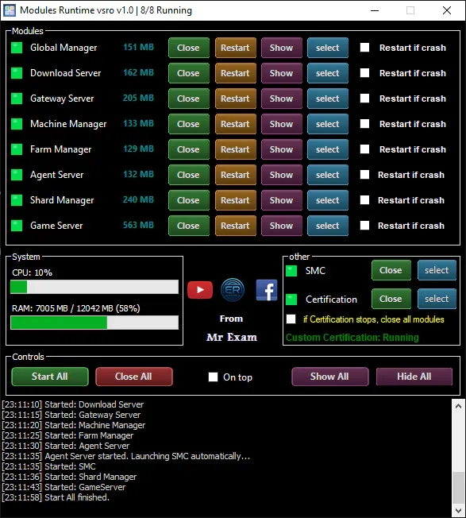

# Modules-Runtime
Modules-Runtime silkroad Vsro server file, Simple tool to start all modules with just one click

Clean code that you can edit however you like ♥
## Features
- Start server modules in a specific order
- Automatically restart crashed modules
- Monitor module status
- Monitor CPU and RAM usage
- Perform an orderly server shutdown
- Hide and restore module windows.

  

## How to use
1. Run the application as administorator
2. Configure the paths for the server modules
3. Start the Certification module
4. Click Start All to start the remaining modules in order
5. Configure automatic restart and other settings as needed.

## Download V1.0

